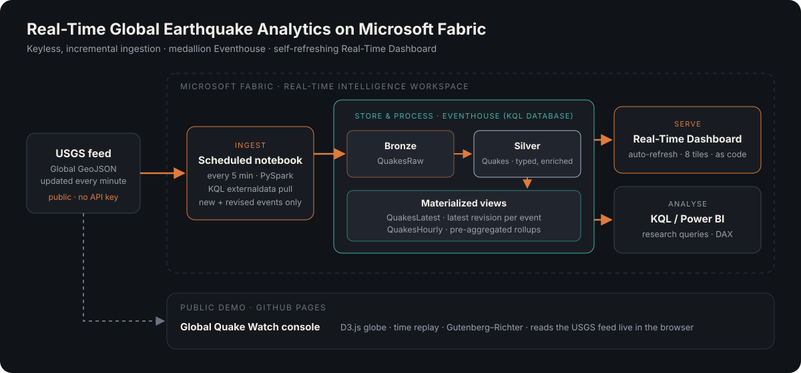
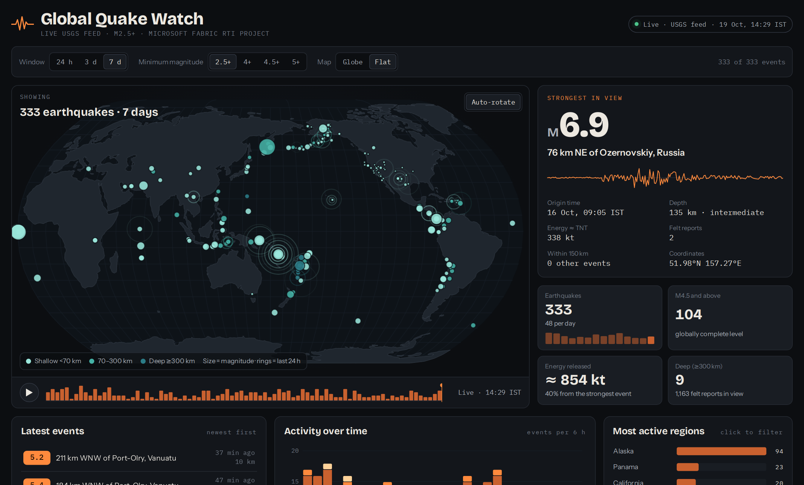

# Real-Time Global Earthquake Analytics on Microsoft Fabric

**An end-to-end real-time analytics pipeline that turns the live USGS earthquake feed into a self-refreshing operational dashboard, built on Microsoft Fabric Real-Time Intelligence.**

[**▶ Live demo**](https://jeyanthponnaluri.github.io/Fabric-realtime-earthquake-analytics/) · [Architecture](#architecture) · [Dashboard](#the-real-time-dashboard) · [Engineering decisions](#key-engineering-decisions) · [Run it yourself](#run-it-yourself)

    

---

## Why this project

Seismologists, disaster-response teams and researchers need to know what is happening **now**, not what a report said yesterday. The U.S. Geological Survey publishes a global earthquake feed that updates every minute. But a raw feed is not insight: events arrive as GeoJSON and are revised repeatedly as more seismometers report in, so naive loading double-counts and mis-reports magnitudes.

This project builds the full path from raw signal to live insight:

- **Automatic ingestion** every 5 minutes, loading only new or revised events
- **A medallion data model** in a Fabric Eventhouse (KQL database)
- **Materialized views** that always serve the latest revision of every event
- **A Real-Time Dashboard** that refreshes itself, deployed as code through the Fabric REST API
- **A public web console** (this repo's GitHub Pages site) that reads the same feed live in the browser

## Architecture



| Layer | Fabric item | What it does |
|---|---|---|
| Source | USGS GeoJSON feed | Global M0+ events, updated every minute, public domain, no API key |
| Ingest | `nb_usgs_ingest` notebook, scheduled every 5 min | Calls the Eventhouse management API. The Eventhouse pulls the feed itself with KQL `externaldata` and appends only new or revised events. |
| Bronze | `QuakesRaw` table | Raw events exactly as received (audit trail, replayable) |
| Silver | `Quakes` table | Typed and enriched: magnitude band, depth class, region, quality flags, ingestion time |
| Serving | `QuakesLatest` materialized view | `arg_max` by event ID, so dashboards never double-count revisions |
| Serving | `QuakesHourly` materialized view | Pre-aggregated hourly counts by magnitude band, so heavy tiles stay instant |
| Presentation | `Quake Live` Real-Time Dashboard | 8 auto-refreshing tiles, defined and deployed as code |
| Public demo | GitHub Pages (`docs/index.html`) | D3.js console that reads the USGS feed client-side |

## The Real-Time Dashboard

<!-- Add a screenshot of the Fabric dashboard: save it as screenshots/fabric-dashboard.png and add  here -->

| Tile | What it shows | Why it matters |
|---|---|---|
| **Live status** (KPI strip) | Quakes in 24 h, M4.5+ count, strongest of the week, energy released (TNT-equivalent), deep events, minutes since last pipeline run | Headline state of the planet plus pipeline health at a glance |
| **Map** | Every M4+ event in 7 days, coloured by magnitude band | Plate boundaries and the Pacific Ring of Fire emerge from the data |
| **Latest M4+ earthquakes** | Rolling table in IST, severity-coloured | The "what just happened" view for a response desk |
| **Activity by magnitude band** | Stacked counts per 6 hours | Baseline vs spikes; aftershock sequences stand out |
| **Depth cross-section** | Magnitude vs depth, by depth class | Deep (300–700 km) events reveal subducting plates |
| **Most active regions** | Top 10 regions, M4+ | Where the planet is busiest this week |
| **Pipeline heartbeat** | New rows ingested per 15 min | Observability: a flat line means ingestion stopped |
| **Strongest this week** | Top 8 events with energy in kt TNT | Shows the logarithmic scale: one step in magnitude is about 32× the energy |

Energy uses the Gutenberg–Richter energy relation, log₁₀E = 1.5M + 4.8 (joules), converted at 4.184 × 10¹² J per kiloton.

## Public live demo

**[jeyanthponnaluri.github.io/Fabric-realtime-earthquake-analytics](https://jeyanthponnaluri.github.io/Fabric-realtime-earthquake-analytics/)**

[](https://jeyanthponnaluri.github.io/Fabric-realtime-earthquake-analytics/)

<sub>Screenshot refreshed daily by a GitHub Actions workflow (`.github/workflows/screenshot.yml`) that opens the live demo in headless Chromium.</sub>

The Fabric dashboard needs a Fabric sign-in, so this repo also ships a public console that anyone can open. It fetches the USGS M2.5+ past-7-days feed directly in the visitor's browser and offers:

- An interactive **globe or flat map**, with time **replay** of the week
- A **spotlight** on the strongest event, with a synthetic seismogram trace
- KPIs, a latest-events feed, activity over time, and regions you can click to filter
- **Gutenberg–Richter** frequency–magnitude analysis, a depth profile, and aftershock sequence detection
- A quiet auto-update every 5 minutes, with a retry prompt if the feed is unreachable

It is a single self-contained HTML file (`docs/index.html`, D3.js v7, no build step, no server).

## Key engineering decisions

**1. Keyless ingestion instead of a producer plus event hub.**
The first design used a Python producer pushing to an Eventstream (`producer/`). The deployed version lets the Eventhouse fetch the feed itself with KQL `externaldata`, triggered by a scheduled notebook that authenticates with the owner's Fabric (Entra ID) token. There are no connection strings, no secrets to rotate, and no always-on VM.

**2. Incremental, idempotent loads.**
`Fn_UsgsNewEvents()` anti-joins the incoming feed against what is already stored on **(EventId, Updated)**. Re-running a load never duplicates data, and revisions are captured as new versions rather than overwrites, which keeps a full audit trail in bronze.

**3. Revisions handled in the serving layer.**
USGS revises magnitudes and locations after first publication. `QuakesLatest` (`arg_max(Updated, *) by EventId`) guarantees every query sees exactly one, latest, row per earthquake. Counting the raw tables would over-count.

**4. Pre-aggregation for cheap dashboards.**
Time-series tiles read `QuakesHourly` instead of scanning raw events, so refreshes stay fast and capacity usage stays low.

**5. Parsing robustness.**
The `multijson` format returned the whole feed as one object, so the function reads the feed as text and parses each `Feature` line individually with `parse_json`. Property names are bracketed (`p["time"]`) to avoid KQL keyword collisions.

**6. Dashboard as code.**
`fabric/dashboard/dashboard_as_code.py` pulls the dashboard definition through the Fabric REST API (`getDefinition`), rebuilds all tiles, queries, layout and colour rules programmatically, and pushes it back (`updateDefinition`), keeping a one-line rollback (`push(B)`). That makes the dashboard reviewable, versioned and reproducible.

**7. Scientific caveats built in.**
- The global catalogue is only complete from about M4.5. Smaller events are dense near US networks, so geographic tiles filter to M4+ to avoid a misleading US bias.
- Quarry blasts and explosions are excluded (`EventType == "earthquake"`).

## Results

- **10,600+ events** backfilled (30 days) and growing continuously
- New data visible on the dashboard within **about 5 minutes** of USGS publication
- Pipeline ran unattended on schedule, monitored by the heartbeat tile and the Fabric Monitor hub
- Zero secrets in code or configuration

## Repository structure

```
├── docs/                         GitHub Pages site
│   ├── index.html                Live public console (single file, D3.js)
│   └── architecture.svg          Architecture diagram
├── fabric/
│   ├── kql/
│   │   ├── 00_setup_one_script.kql          Tables, update policy, materialized views (one script)
│   │   ├── 01_eventhouse_setup.kql          Step-by-step setup with mappings and retention
│   │   ├── 02_dashboard_and_research_queries.kql   Dashboard + research queries (b-value, Omori decay, anomalies)
│   │   ├── 03_keyless_ingestion.kql         Fn_UsgsNewEvents(): externaldata + incremental anti-join
│   │   ├── 04_refresh_function.kql          Fn_NewSilverRows(): bronze → silver
│   │   └── 05_dashboard_tiles.kql           Tile queries
│   ├── notebooks/nb_usgs_ingest.py          Scheduled ingestion notebook (every 5 min)
│   └── dashboard/dashboard_as_code.py       Real-Time Dashboard definition via Fabric REST API
├── powerbi/measures.dax          DAX measures for a Power BI report (DirectQuery / Direct Lake)
├── producer/usgs_to_eventstream.py   Alternative route: Python producer → Eventstream (Event Hub protocol)
├── .github/workflows/screenshot.yml  Daily CI job that screenshots the live demo for this README
└── screenshots/                  Fabric dashboard, pipeline and demo screenshots
```

## Run it yourself

**Prerequisites:** a Microsoft Fabric capacity (a free trial works) and a workspace.

1. **Create an Eventhouse** named `QuakeHouse`.
2. **Run `fabric/kql/00_setup_one_script.kql`** in its KQL database. This creates the tables, functions and materialized views.
3. **Run `03_keyless_ingestion.kql` and `04_refresh_function.kql`.** These create the ingestion functions. The backfill command at the end of `03` loads the last 30 days.
4. **Create a notebook** from `fabric/notebooks/nb_usgs_ingest.py`. Set your workspace and Eventhouse IDs, run it once, then **Run → Schedule** it every 5 minutes.
5. **Create a Real-Time Dashboard** with one tile from `05_dashboard_tiles.kql`, or run `fabric/dashboard/dashboard_as_code.py` in a notebook to generate the full layout.
6. **(Optional)** Open `docs/index.html` locally to run the public console.

## Tech stack

Microsoft Fabric (Real-Time Intelligence, Eventhouse / KQL Database, Real-Time Dashboards, Notebooks, Monitor hub) · Kusto Query Language · PySpark / Python · Fabric REST API · Power BI / DAX · D3.js · GitHub Pages

## What I would add next

- Swap the 5-minute poll for an **Eventstream** to reach second-level latency
- An **Activator** rule to push Teams or email alerts for M6+ or tsunami-flagged events
- **OneLake availability** plus a Lakehouse shortcut for multi-year research on Direct Lake
- Region normalisation (merging "Japan" and "Japan region"), and a magnitude-type harmonisation layer

## Data and credits

Earthquake data: **U.S. Geological Survey, Earthquake Hazards Program**, ANSS Comprehensive Catalog ([feed documentation](https://earthquake.usgs.gov/earthquakes/feed/v1.0/geojson.php)). Public domain.

Code released under the MIT License.
